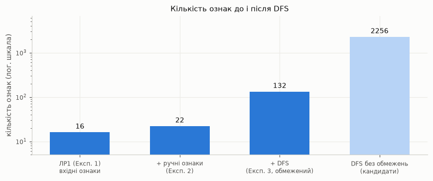
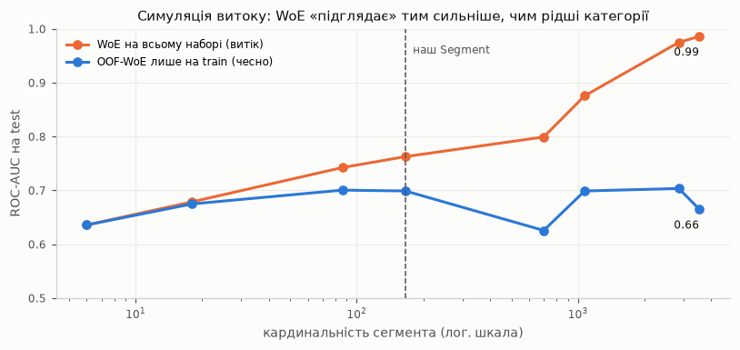

# ЛР2. Мультимодальна інженерія та відбір ознак

Простір ознак спершу розширюється (ручні ознаки → текст і зображення → Featuretools DFS), потім звужується трирівневим відбором.
В Експерименті 4 витік даних зроблено **навмисно**: він локалізований і задокументований, а виправлятиметься в ЛР3.
Клас `DynamicPipelineBuilder` з ЛР1 не переписувався. Розширення зроблено через YAML: нові кроки в `transform_policy` і нова секція `feature_engineering`.

Усі числа взято з [notebooks/02_multimodal_leakage.ipynb](../notebooks/02_multimodal_leakage.ipynb). Таблиці лежать у `reports/lab2_*.csv`, графіки — у `reports/lab2_*.png`.

**Що змінилось у даних порівняно з ЛР1.** Видалено **556 точних дублікатів**: це рядки, що повністю повторюють інший, крім `CustomerID`, і конфліктних міток серед них немає. Набір зменшився з 5 630 до 5 074 рядків, відтік — 16.57%.
Без цього копії потрапили б і в train, і в test, тобто витік був би в усіх експериментах (REFORMS 6b, 4a). Сирий файл не змінювався: очищення виконує `src/data.py` за прапорцем у `config/data.yaml`.
Розбиття одне для всіх експериментів: **70/30**, стратифіковане, `random_state=42`. Це 3 551 / 1 523 рядки.

---

## 1. Крок 1 — ручний дизайн ознак (п. 4.1)

Конструктори описано в секції `feature_engineering` у [config/config_lr_fe.yaml](../config/config_lr_fe.yaml). Класи — у [src/features.py](../src/features.py).
Конструктори безстанові: вони нічого не вчать з даних, тому не можуть бути джерелом витоку. Стан має лише OOF-WoE.

| Категорія | Метод | Ознаки | Чому саме він |
|---|---|---|---|
| **А. Часові** | **Бінінг за експертними межами** (`IntervalBinner`) + **циклічне sin/cos** (`CyclicalEncoder`) | `TenureStage` (0 — новий ≤ 1 міс., 1 — ранній ≤ 5, 2 — постійний ≤ 12, 3 — лояльний); `review_hour`, `review_dow` → sin/cos (для відгуків, Крок 2) | Дат у таблиці клієнтів **немає**, тож sin/cos застосовувати нема до чого. Час представлено стажем. Межі етапів — бізнесові, а не з даних: відтік різко змінюється між «новим» і «раннім» клієнтом (EDA ЛР1: 52% проти 8%). Для адитивної моделі етап дає ступінчастий ефект, якого немає в лінійному `log(Tenure)`. Для дерев він переважно дублює `Tenure`. Циклічне кодування використане там, де є справжні мітки часу — у відгуках: 23:00 і 00:00 стають сусідами. |
| **Б. Взаємодії й трансформації** | **Захищені відношення** (`SafeRatio`, ε = 1e-5) + **Yeo-Johnson** (`yeo_johnson`, крок `transform_policy`) | `CashbackPerOrder`, `CouponPerOrder`, `OrdersPerTenureMonth` (стаж + 1 міс.), `RecencyRatio` = днів з останнього замовлення / (стаж у днях + 1) | Відношення виражають *інтенсивність*: кешбек на замовлення, частоту замовлень, «свіжість» відносно стажу. Логістична регресія сама добуток чи частку двох ознак не побудує, а дерево будує лише кусково. Yeo-Johnson, на відміну від Box-Cox, працює з нулями (`CouponUsed = 0`) і стабілізує дуже скошені відношення (асиметрія до ~20) — для `additive`. Для `partitioning` лишається вінсоризація 1–99%, бо монотонні перетворення дереву нічого не дають. |
| **В. Висока кардинальність** | **Схрещення** (`CategoryCrosser`) + **Out-of-fold WoE** (`OOFWoEEncoder`, 5 стратифікованих фолдів, згладжування 0.5) | `Segment` = категорія × сімейний стан × задоволеність × пристрій (**164** значення на train); OOF-WoE також для номінальних ознак у родині `additive` | Природних ознак високої кардинальності в наборі немає (максимум 6 значень). Поведінковий сегмент — типовий прийом e-commerce, і він створює саме ту ситуацію, де звичайний WoE з ЛР1 перенавчається. OOF кодує кожен фолд train вагами з решти фолдів, тож рядок не бачить своєї мітки. Для дерев сегмент теж кодується OOF-WoE, бо one-hot на 164 значення роздув би простір. M-estimate не обрано: він лише зменшує зсув для рідкісних категорій, але не прибирає «власну мітку» з оцінки. |

**Як змінився WoE з ЛР1.** Клас `WoEEncoder` перенесено в `src/features.py`, а `OOFWoEEncoder` — його регуляризована версія.
- `fit_transform(train)` повертає OOF-значення. Саме їх під час навчання викликає sklearn `Pipeline`.
- `transform(test)` використовує ваги, пораховані на всьому train.

Ефект на ознаці `Segment`:

| Кодувальник | ROC-AUC на train | ROC-AUC на test |
|---|---|---|
| WoE (ЛР1) | 0.777 | 0.699 |
| OOF-WoE (ЛР2) | 0.702 | 0.699 |

Звичайний WoE на train «обіцяє» на 0.08 більше, ніж дає. Оцінка OOF-WoE на train чесна.

---

## 2. Крок 2 — мультимодальна екстракція (п. 4.2)

**Джерело:** [Amazon Reviews 2023](https://amazon-reviews-2023.github.io) (McAuley Lab), файли `raw/review_categories/*.jsonl` на HuggingFace.
З п'яти категорій беремо перші 8–20 тис. рядків: Electronics, Cell_Phones_and_Accessories, Clothing_Shoes_and_Jewelry, Grocery_and_Gourmet_Food, Home_and_Kitchen. Параметри — у [config/multimodal.yaml](../config/multimodal.yaml).

**Прив'язка до клієнтів** (`link_reviews_to_customers`). Спільного ключа між корпусом і таблицею немає (ТЗ, розділ 3), тому зв'язок імітується. Кожен клієнт отримує `min(OrderCount, 5)` відгуків:
- з категорії Amazon, що відповідає його `PreferedOrderCat`. Якщо категорію пропущено — зі змішаного пулу;
- з оцінкою, найближчою до `SatisfactionScore`.

Кожен відгук дістається **одному** клієнту. Ціль `Churn` у прив'язці не використовується. Результат: **12 026 відгуків** для 5 074 клієнтів, від 1 до 5 на клієнта (середнє 2.37).
Через побудову прив'язки оцінка відгуку **на 100%** дорівнює `SatisfactionScore` клієнта.

**Екстрактори** ([src/extraction.py](../src/extraction.py)):

| Екстрактор | Метод | Залежний від даних? | Порожній вхід |
|---|---|---|---|
| `TextExtractor` | `TfidfVectorizer(max_features=500)` → `TruncatedSVD(n_components=5)` на «заголовок + текст» | **так**: словник, IDF і SVD вчаться у `fit`. У чесних експериментах — **лише на відгуках train-клієнтів** | порожній текст → NaN у всіх 5 компонентах; 2 із 12 026 |
| `ImageExtractor` | GLCM (`graycomatrix` + `graycoprops`: contrast, correlation, energy, homogeneity), 32 рівні сірого, усереднення за 4 напрямками | ні: кожне фото обробляється незалежно | немає фото, файл не завантажився або битий → NaN. Із 727 посилань завантажено 706 (21 недоступне), битих файлів 0; 11 320 відгуків без фото |

Фото є лише у ~6% відгуків, тож у 86–87% клієнтів немає жодного фото. GLCM-агрегати потрапляють у гілку політики «> 40% пропусків»: константа + індикатор.

**Перевірка інформативності** (до AutoFE). Логістична регресія statsmodels на train: базові ознаки ЛР1 порівнюються з базовими + середнім мультимодальним блоком (5 SVD-компонент, 4 GLCM-ознаки, частка відгуків із фото).

| Модель | Ознак | AIC | pseudo-R² | LR-тест, p |
|---|---|---|---|---|
| базові ознаки ЛР1 | 17 | **1951.0** | 0.3998 | — |
| + мультимодальний блок, SVD = 5 | 31 | 1960.2 | 0.4038 | 0.546 |
| + блок, SVD = 10 | 36 | 1966.0 | 0.4052 | 0.589 |
| + блок, SVD = 20 | 46 | 1979.9 | 0.4071 | 0.771 |

**Приросту немає:** AIC погіршується, тест відношення правдоподібностей незначущий. Збільшення `n_components` не допомагає, тому лишаємо дефолт 5. Пояснення — у природі корпусу:
- це **паралельний корпус** (інші люди, інший магазин);
- прив'язка передає в текст лише вже наявні в таблиці категорію і задоволеність.

Висновок для Кроку 3: синтез поверх цього блоку переважно додає шум. Це підтверджують експерименти 3–4 і відбір (§5).

---

## 3. Крок 3 — AutoFE (Featuretools DFS, п. 4.3)

**EntitySet:** `clients` (1) — `reviews` (N) за `CustomerID`.
- **Вхід DFS:** 8 числових колонок клієнта (без захищених) і 16 колонок відгуку (оцінка, довжина, 5 SVD, 4 GLCM, `has_image`, 4 циклічні).
- **Параметри:** `max_depth=2`, `agg_primitives=[mean, max, count]`, `trans_primitives=[natural_logarithm, divide_numeric]`. У featuretools 1.31 примітив `log` з ТЗ називається `natural_logarithm`.

**«Вибух розмірності»:**
- повний DFS дає **2 234 кандидати**, з них 1 584 — відношення агрегатів на глибині 2;
- за правилом з конфігу (`dfs.keep`) залишено всі ознаки глибини ≤ 1 і логарифми агрегатів невід'ємних величин — **110 нових ознак**;
- простір ознак зростає з **16** (ЛР1) → **22** (+ ручні) → **132** (+ DFS), тобто у **8.3 раза**.



DFS безстановий: кожна ознака рахується з рядків одного клієнта. Тому запуск на всіх клієнтах не переносить інформацію між train і test, якщо вхідні SVD-компоненти навчено лише на train.
Нескінченності від ділення на 0 і `log(0)` перетворюються на NaN, а далі їх обробляє `AdaptiveImputer`.

Назви DFS-ознак відомі лише після синтезу, тому конфігурації Експериментів 3–4 **генеруються кодом** у `config/generated/`. Це базова FE-конфігурація плюс група `multimodal_dfs`: `yeo_johnson` для `additive`, вінсоризація для `partitioning`.

### Повторна перевірка захищених ознак після DFS (CACE)

| Перевірка | Результат |
|---|---|
| `CityTier` / `Gender` у вході DFS | немає |
| `CityTier` / `Gender` у назвах згенерованих ознак | немає |
| `run_verification.py` (`test_idempotent`, `test_protected_excluded`) на `config/generated/config_{lr,rf}_{full,leaky}.yaml` | **пройдено** (8 конфігурацій) |
| Конструктори ознак не беруть захищені ознаки як вхід | нова перевірка `validate_feature_engineering` у [src/pipeline.py](../src/pipeline.py), тест `test_constructor_on_protected_is_blocked` |
| Чи стали DFS-ознаки проксі: ε² (Kruskal–Wallis) з групою, на train | з `Gender` — 0 ознак з ε² ≥ 0.01. З `CityTier` — 3 ознаки з малим ефектом (ε² = 0.014–0.019), і **всі вони похідні від `CashbackAmount`**, сира колонка якого має той самий зв'язок (ε² = 0.018) |

**Висновок:** DFS не створив нового проксі, а лише успадкував слабкий зв'язок кешбеку з рівнем міста. Головним проксі `CityTier` лишається `PreferredPaymentMode` (Cramér's V = 0.44, ЛР1). Кешбек-ознаки додано до списку на перевірку справедливості в ЛР3.

---

## 4. Крок 4 — експерименти і пастка витоку (п. 4.4)

`LogisticRegression(max_iter=1000)` використовує `config_lr*` (`additive`), `RandomForestClassifier(n_estimators=200)` — `config_rf*` (`partitioning`). Розбиття 70/30, метрика ROC-AUC на test.

| Експеримент | Що змінюється | ROC-AUC LR | ROC-AUC RF |
|---|---|---|---|
| **0. Non-ML Heuristic** | правило ЛР1 «Tenure ≤ 1 АБО скарга», без навчання | 0.740 | 0.740 |
| **1. Baseline** | препроцесор ЛР1, без нових ознак | 0.869 | **0.962** |
| **2. Manual FE** | + конструктори Кроку 1, OOF-WoE | 0.877 | 0.957 |
| **3. Extracted + AutoFE** | + текст, зображення, DFS; чесний відбір **усередині** train (Filter k=30 → SFS 15) | 0.829 | 0.918 |
| 3′. те саме без відбору | для контексту | **0.890** | 0.926 |
| **4. Leaky Pipeline** | TF-IDF/SVD, WoE, Filter і SFS навчаються **до** розбиття | 0.860 | 0.927 |

**Інтерпретація:**
- **REFORMS 1c підтверджено:** усі моделі суттєво перевершують евристику (0.74).
  - Ціль ML Canvas — Precision ≥ 0.50 при Recall ≥ 0.80. RF досягає **0.81** (Експ. 1) і 0.78 (Експ. 2). LR не досягає: 0.45 і 0.47.
  - Застереження: поріг для цієї оцінки підібрано на test, тож вона оптимістична. Чесний вибір порогу — у ЛР3 (cost-sensitive).
- **Ручні ознаки** допомагають адитивній моделі (+0.008): відношення й етапи дають їй нелінійність, якої вона сама не побудує. Лісу не допомагають (−0.005): він сам знаходить ці взаємодії.
- **Мультимодальний блок і DFS** на нашому корпусі шуму не прибирають, а додають:
  - RF без відбору — 0.926 проти 0.962 у Baseline: шумові ознаки розмивають вибір розбиттів;
  - LR без відбору виграє (0.890), але завдяки DFS-відношенням колонок *клієнта*, а не тексту чи фото (§5);
  - жорсткий відбір до 15 ознак втрачає корисні для лісу ознаки (`Complain`, `NumberOfAddress`), бо SFS обирає підмножину під логістичну регресію.
- Порівняння **3 vs 4** — це той самий простір і та сама процедура, але з витоком: **+0.031 (LR), +0.009 (RF)**. Цей розрив — доказ витоку. Він менший за орієнтир ТЗ (0.97–1.00), і нижче пояснено чому.

### Точний рядок з витоком

Ноутбук `02_multimodal_leakage.ipynb`, комірка «Експеримент 4»:

```python
text_ex_leaky = TextExtractor(...).fit(review_texts(reviews).to_frame())  # ← ВИТІК №1: TF-IDF/SVD бачать тексти test
prep_leaky.fit(X4, y)                     # ← ВИТІК №2 (ГОЛОВНИЙ): WoE рахує частки відтоку на ВСІХ рядках, включно з мітками test
flt = make_filter(sel_cfg).fit(Z_all, y)  # ← ВИТІК №3: Filter обирає ознаки за мітками test
sfs = make_sfs(sel_cfg).fit(Z_f, y)       #   і SFS оцінює підмножини на CV, що включає test
Z_tr, Z_te = Z_s[idx_tr], Z_s[idx_te]     # розбиття — ПІСЛЯ всіх обчислень
```

| Що протекло з test у train | Механізм |
|---|---|
| **словник TF-IDF, IDF-ваги, напрямки SVD** (без міток) | компоненти орієнтовані й на варіацію тестових текстів. Витік слабкий, бо неконтрольований |
| **частки відтоку в категоріях `Segment` і номінальних ознак** (з мітками) | WoE(c) = ln[((p_c + α)/(P + αK)) / ((n_c − p_c + α)/(N + αK))]: мітка тестового рядка *i* входить у *p_c* його ж категорії. Внесок ≈ 1/n_c. Для сегмента з одного рядка WoE однозначно кодує мітку: ≈ ln((1+α)/α) для відтоку, ≈ ln(α/(1+α)) для решти |
| **склад ознак** (з мітками) | SelectKBest (mutual information) і SFS (CV ROC-AUC) обирають ознаки, які найкраще працюють *на тих самих тестових рядках* |

**Симуляція витоку.** Модель на одній ознаці-сегменті, що схрещує дедалі більше колонок:



| Колонок у сегменті | Кардинальність | Чесно (OOF на train) | З витоком (WoE на всьому наборі) |
|---|---|---|---|
| 1 | 6 | 0.636 | 0.636 |
| 4 (наш `Segment`) | 166 | 0.699 | 0.763 |
| 6 | 1 072 | 0.699 | 0.876 |
| 8 | 3 539 | 0.665 | **0.986** |

Чесна оцінка стоїть на ~0.70, а оцінка з витоком зростає разом із кардинальністю до 0.99 — це діапазон, на який орієнтує ТЗ. На нашому сегменті (у середньому ~30 рядків на категорію) витік помітний, але помірний.

### Перший розрахунок справедливості (DPR, EOR) — Експерименти 1 і 4

> ⚠️ **Ненадійно.** Експеримент 4 містить навмисний витік. Довірчий розрахунок можливий лише в ЛР3, після герметизації конвеєра і вкладеної CV.

Деталі розрахунку:
- поріг рішення 0.5;
- привілейована група — **Tier 1**;
- DPR = частка позитивних рішень групи / частка в Tier 1;
- EOR = TPR групи / TPR Tier 1;
- орієнтир — правило 4/5 (0.80).

| Експ. | Модель | Tier 2 (n = 48, 12 відтоків): DPR / EOR | Tier 3 (n = 491, 107 відтоків): DPR / EOR |
|---|---|---|---|
| 1. Baseline | LR | 1.78 / 1.36 | 1.50 / 1.13 |
| 1. Baseline | RF | 1.12 / **0.71** | 1.59 / 1.05 |
| 4. Leaky | LR | 1.10 / 0.87 | 1.16 / **0.80** |
| 4. Leaky | RF | 1.08 / **0.69** | 1.44 / 1.01 |

- **DPR > 1** для Tier 2–3: моделі частіше позначають клієнтів менших міст. Це узгоджується з їхнім вищим базовим відтоком (19.8% і 21.4% проти 14.5%), тож DPR тут не показник несправедливості. Саме тому для домену обрано **EOR** (ЛР1).
- **Масштаб спотворення:** для LR витік змінив EOR Tier 3 з 1.13 до **0.80**, тобто з «Tier 3 ловимо краще» на «ледь проходимо правило 4/5». Частка позитивних рішень Tier 3 впала з 0.141 до 0.110. Висновок про справедливість змінився лише через порядок обчислень, без жодної зміни в даних.
- **Tier 2** має лише 12 відтоків у test, тому EOR 0.69–0.71 у RF статистично нестабільний: одна помилка змінює TPR на 0.08.
- **За статтю** (довідково): EOR жінок 0.83–1.08 залежно від моделі й експерименту, DPR 0.97–1.13.

---

## 5. Крок 5 — статистика, потім відбір (п. 4.5)

Усі розрахунки — на тренувальній матриці Експерименту 3 (`config_lr_full.yaml`, препроцесор навчено на train): **3 551 × 188** ознак після препроцесора, з індикаторами пропусків. Параметри — у [config/selection.yaml](../config/selection.yaml), код — у [src/selection.py](../src/selection.py).

**Базова статистика (до формального відбору):**
- **514 пар з |r| > 0.9** (див. `reports/lab2_basic_stats.png`) і 1 константна ознака;
- з 30 найкращих за Filter **23 мають VIF > 10**.

Джерела дублювання:
- ознака і її логарифм; прямі й обернені відношення (`a / b`, `b / a`);
- індикатори пропусків GLCM-ознак: усі дорівнюють «немає фото»;
- **дублікати за побудовою:**

  | Пара | r |
  |---|---|
  | `MEAN(reviews.rating)` і `SatisfactionScore` | 0.9999 |
  | `COUNT(reviews)` і `OrderCount` (Spearman) | 0.996 |
  | ручна `CashbackPerOrder` і DFS-ознака `CashbackAmount / OrderCount` | 1.000 (VIF ≈ 3·10¹¹) |

  Остання пара показує: DFS знову згенерував ознаку, яку ми вже сконструювали вручну.

**Відбір (за зростанням вартості):**

| Рівень | Метод | Результат |
|---|---|---|
| Filter | `SelectKBest(mutual_info_classif, k=30)` | 188 → 30. Лідирують відношення зі стажем (`Tenure / OrderCount`, `OrdersPerTenureMonth`, `RecencyRatio`, `TenureStage`) |
| Hybrid (Wrapper) | Filter → `mlxtend.SequentialFeatureSelector(forward, k_features=15, scoring=roc_auc, cv=3)` | 30 → 15; CV ROC-AUC на train швидко росте до 4–6 ознак (≈ 0.85), далі плато (`reports/lab2_sfs_path.png`) |
| Embedded | `LogisticRegression(penalty="l1", solver="liblinear", C=0.05)` | ненульові коефіцієнти в 26 з 188 |
| Tree-based | `permutation_importance` RF на відкладених 25% train | топ: `Complain`, `NumberOfAddress`, `Tenure / WarehouseToHome`, `Tenure`, `Tenure / OrderAmountHikeFromlastYear` |

**Згода методів** (`reports/lab2_selection_comparison.csv`):
- `WarehouseToHome / Tenure` і `OrdersPerTenureMonth` обрали **всі 4** методи;
- `Tenure`, `Tenure / OrderCount`, `Segment`, `Tenure / WarehouseToHome` — 3 методи.

Склад 15 ознак, обраних SFS:
- 1 WoE-закодована категорія (`Segment`);
- 1 ручна ознака (`OrdersPerTenureMonth`). Інші ручні (`RecencyRatio`, `TenureStage`) пройшли Filter, але SFS їх не взяв;
- 1 сира ознака (`CashbackAmount`);
- 12 DFS-ознак: відношення колонок клієнта і `log(CashbackAmount)`.

**Мультимодальних ознак (текст, фото) у топі немає**, що узгоджується з перевіркою інформативності (§2).

Wrapper (SFS) і Filter обирають ознаки під логістичну регресію і пропускають `Complain` та `NumberOfAddress`, які найважливіші для лісу. Через це Експеримент 3 з відбором слабший за 3′ без відбору.

---

## 6. REFORMS: модулі 3, 4 і 6

### Модуль 3. Якість даних

| № | Відповідь |
|---|---|
| **3a** Джерела | **(1) Таблиця клієнтів:** Kaggle, «Ecommerce Customer Churn Analysis and Prediction» (Ankit Verma, 2021), `E Commerce Dataset.xlsx`, аркуш `E Comm`. Дані анонімної онлайн-компанії. Час збору на сторінці не вказано: знімок «за останній місяць», дата невідома. Мітка `Churn` — прапорець компанії, процес його визначення не задокументовано. Train і test — **одне джерело**, розбите 70/30 після дедуплікації. **(2) Корпус:** Amazon Reviews 2023, McAuley Lab (Hou et al., 2024, arXiv:2403.03952). Відгуки Amazon.com за 1996–2023, зібрані авторами корпусу. «Мітка» корпусу (оцінка 1–5) поставлена самими покупцями. Використано перші 8–20 тис. рядків п'яти категорій. Фото — посилання покупців у відгуках, завантажені 04.11.2026: 706 з 727, 21 недоступне. |
| **3b** Вибіркова рамка | **(1)** Як у ЛР1 (1a): клієнти одного рітейлера, імовірно Індія, активні в момент знімка. **(2)** Покупці Amazon.com (переважно США), які написали відгук. Вибірка — **перші рядки файлів** категорій, а не випадкова, тож порядок рядків у файлі (за товарами чи часом) визначає, які відгуки потрапили. |
| **3f** Пропуски за класом (train) | Таблиця нижче. **Природні пропуски не випадкові щодо цілі:** у `Tenure` їх 8.7% серед тих, хто пішов, проти 4.0% серед решти; у `WarehouseToHome` 7.6% проти 3.8%; у `CouponUsed` і `OrderCount` навпаки, 0.8–1.9% проти 4.9%. Отже, механізм ближчий до MAR/MNAR, ніж до MCAR, а індикатор пропуску може нести сигнал. Інжектовані MCAR-пропуски (`CashbackAmount`, `PreferedOrderCat`) розподілені рівномірно, як і очікується. **Приховані пропуски сирих джерел** (`ImageExtractor.stats_`, `TextExtractor.stats_`): порожніх текстів 2 з 12 026; відгуків без фото 11 320; не завантажилось 21; битих файлів 0. Клієнтів без жодного фото: 87.2% (Churn = 0) і 85.9% (Churn = 1). |
| **3g** Репрезентативність | Рамки **не збігаються**. Табличний набір — клієнти одного (імовірно індійського) рітейлера; корпус — покупці Amazon.com, переважно США, з іншими товарами й іншою мовою спілкування. Прив'язка імітаційна: відгук «належить» клієнту лише за категорією і задоволеністю. Тому мультимодальні ознаки **не можуть підтримувати жодних тверджень** про популяцію з 1a. Вони демонструють лише механіку екстракції. Перевірка інформативності це підтверджує: значущого внеску немає. |

Пропуски за класом на train, %:

| Колонка | Churn = 0 | Churn = 1 |
|---|---|---|
| Tenure | 4.0 | 8.7 |
| WarehouseToHome | 3.8 | 7.6 |
| HourSpendOnApp | 4.3 | 5.9 |
| OrderAmountHikeFromlastYear | 5.7 | 1.7 |
| CouponUsed | 4.9 | 0.8 |
| OrderCount | 4.9 | 1.9 |
| DaySinceLastOrder | 5.0 | 7.0 |
| CashbackAmount *(MCAR, інжектовано)* | 19.5 | 21.1 |
| PreferedOrderCat *(MCAR, інжектовано)* | 15.1 | 16.3 |

### Модуль 4. Препроцесинг даних

| № | Відповідь |
|---|---|
| **4a** Виключення спостережень | **Тепер релевантний.** Видалено 556 точних дублікатів (усі колонки, крім `CustomerID`, без конфліктних міток), щоб копії не потрапили одночасно в train і test. Через мультимодальний блок **жодного** рядка не втрачено: кожен клієнт має ≥ 1 відгук, відсутнє фото — це NaN, а не виключення. |
| **4b** Неможливі / зіпсовані значення | `SafeRatio`: знаменник + ε (1e-5; для відношень зі стажем + 1 міс. / + 1 день, бо `Tenure = 0` — реальні нові клієнти), `±inf → NaN`, NaN в операнді → NaN у результаті. DFS: `divide_numeric` на 0 і `log(0)` → `±inf → NaN`. `TextExtractor`: порожній текст → NaN. `ImageExtractor`: немає шляху / немає файлу / виняток при читанні → NaN + лічильник. `CategoryCrosser`: пропуск складової → токен `NA`. Неузгоджені мітки категорій зводяться `ValueAliasMapper` (з ЛР1). Усі NaN далі обробляє `AdaptiveImputer` за політикою ЛР1. |
| **4c** Трансформації від сирих даних до моделі | Таблиця нижче. Критерій «залежна від даних»: чи вчить трансформер щось у `fit`. |

| # | Трансформація | Де | Залежна від даних? |
|---|---|---|---|
| 1 | Видалення точних дублікатів | `src/data.py` | ні (детерміноване правило) |
| 2 | MCAR-інжектування пропусків (seed 42) | `src/data.py` | ні |
| 3 | Прив'язка відгуків до клієнтів (seed 42) | `src/extraction.py` | ні (лише значення рядка, без цілі) |
| 4 | Зведення синонімів категорій | `ValueAliasMapper` | ні |
| 5 | `IntervalBinner`, `SafeRatio`, `CategoryCrosser` | `src/features.py` | ні |
| 6 | TF-IDF → TruncatedSVD | `TextExtractor` | **так** |
| 7 | GLCM | `ImageExtractor` | ні |
| 8 | Циклічне sin/cos часу відгуку | `CyclicalEncoder` | ні |
| 9 | DFS (агрегати, логарифми, відношення по клієнту) | `run_dfs` | ні (кожна ознака — з рядків одного клієнта) |
| 10 | Адаптивна імпутація | `AdaptiveImputer` | **так** (частка пропусків, медіана/мода) |
| 11 | `log1p` | реєстр | ні |
| 12 | `StandardScaler`, Yeo-Johnson, вінсоризація | реєстр | **так** (μ, σ, λ, перцентилі) |
| 13 | OOF-WoE / WoE | `src/features.py` | **так**, і кероване ціллю |
| 14 | One-hot, ordinal | реєстр | **так** (перелік категорій) |
| 15 | `SelectKBest`, `SequentialFeatureSelector` | `src/selection.py` | **так**, керовані ціллю |
| 16 | Модель | — | **так** |

### Модуль 6. Витік даних

| № | Відповідь |
|---|---|
| **6a** Інформація лише з train | **Експерименти 1–3:** розбиття — у першій комірці з даними (`idx_tr, idx_te`). Кожна залежна трансформація з 4c (6, 10, 12–16) навчається після нього і лише на train. `TextExtractor` — на відгуках train-клієнтів. Препроцесор, Filter, SFS і модель — в одному `Pipeline.fit(X_train, y_train)`. Незалежні трансформації (1–5, 7–9, 11) виконуються на всьому наборі, бо не переносять інформацію між рядками. **Експеримент 4:** трансформації 6, 10, 12–15 навмисно виконані на всьому наборі **до** розбиття. Рядки — у §4 («ВИТІК №1–3»). Механізм не виправлено: це завдання ЛР3 (imblearn-пайплайн, вкладена CV, усі параметри керованого кодування, TF-IDF, SVD і відбору — лише у внутрішніх train-фолдах). |
| **6b** Залежності й дублікати між train і test | (1) Видалено 556 точних дублікатів до розбиття. (2) Мультимодальний вектор приєднано **за клієнтом**: кожен відгук корпусу призначено рівно одному клієнту (`corpus_index` унікальний), а розбиття — на рівні клієнтів, тож відгуки клієнта йдуть разом з ним і жоден відгук не опиняється в обох вибірках. (3) Залишкова залежність: 3 фото (однакові URL) повторюються в двох різних відгуках. Вплив на ≤ 3 клієнтів незначний, але це факт. (4) Схожі, але не ідентичні клієнти лишаються, і групового розбиття немає, бо в даних немає ідентифікатора групи. |
| **6c** Легітимність ознак | По групах: **(а) поведінкові ознаки таблиці** — легітимні за умови, що виміряні *до* моменту відтоку. Датасет цього не документує: ризик витоку цілі, якщо, наприклад, `DaySinceLastOrder` пораховано вже після відходу. **(б) Ручні ознаки** — детерміновані функції (а), легітимні. **(в) `Segment` з OOF-WoE** — керований ціллю, але кожен рядок train кодується без своєї мітки, а test — вагами з train. **(г) Мультимодальні й DFS-ознаки** — технічно легітимні (без цілі, без захищених ознак), але змістовно це симуляція: `MEAN(reviews.rating)` за побудовою дублює `SatisfactionScore`, `COUNT(reviews)` — `OrderCount`. **(д) Захищені ознаки** — `CityTier` і `Gender` відсутні в будь-якій гілці конвеєра (`run_verification.py` на 8 конфігураціях, перевірка конструкторів, перевірка DFS). Фінальний перелік ознак після відбору — `reports/lab2_selection_comparison.csv`. |

### Пункти, що не заповнюються

| № | Статус |
|---|---|
| **3c** Корисність набору | Як у ЛР1, не змінилось. |
| **3d** Цільова змінна | Як у ЛР1. Після дедуплікації відтік 16.57% (було 16.84%). |
| **3e** Кількість спостережень | **Змінилась** через дедуплікацію: 5 074 (train 3 551, test 1 523). Мультимодальний блок рядків не скоротив. |
| **4a** | Став релевантним — заповнено вище. |

---

## 7. Обмеження

- Мультимодальний блок імітаційний: на текстах і фото не можна робити висновків про реальних клієнтів (3g).
- Оцінки — на **одному** розбитті 70/30 без довірчих інтервалів. Різниця 0.005–0.01 між експериментами може бути шумом (вкладена CV — у ЛР3).
- Precision при Recall ≥ 0.80 рахувався з порогом, підібраним на test, тож оцінка оптимістична.
- DPR/EOR ненадійні. Для Tier 2 у test лише 12 відтоків.
- SFS оцінює підмножини логістичною регресією, тому відбір не оптимальний для лісу.
