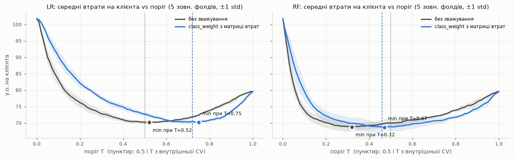
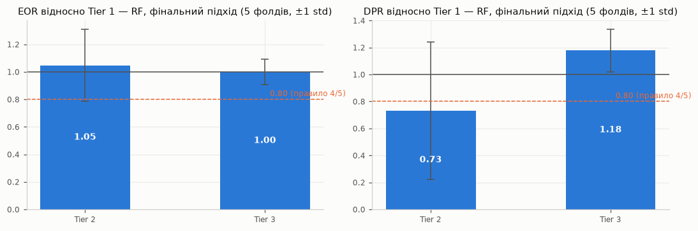

# ЛР3. Герметизація пайплайну: ліквідація витоку, аномалії, дисбаланс, Nested CV

Що зроблено в цій роботі:
- конвеєр ЛР1–ЛР2 перенесено в `imblearn.Pipeline`;
- відбір ознак і текстовий екстрактор тепер навчаються всередині фолдів;
- додано ланку SMOTE;
- якість оцінено вкладеною CV з Optuna;
- бізнес-втрати вбудовано і в навчання, і в поріг;
- метрики справедливості пораховано вперше так, щоб їм можна було довіряти.

Ноутбуки: [lab3_robust_validation.ipynb](../notebooks/lab3_robust_validation.ipynb) і [lab3_fairness.ipynb](../notebooks/lab3_fairness.ipynb).
Таблиці лежать у `reports/lab3_*.csv`, графіки — у `reports/lab3_*.png`.

**Дані.** Обидва набори — виходи стадії DVC `prepare`:
- `data/processed/train.csv` — 4 059 клієнтів, відтік 16.58%. На ньому розробка і вкладена CV;
- `data/processed/holdout.csv` — 1 015 клієнтів. **У ЛР3 не використовується взагалі**, лишається для ЛР4–5.

Коефіцієнт дисбалансу (частка міноритарного класу) — **0.166**.

---

## 1. DVC lineage (п. 4.1)

| Що | Де |
|---|---|
| Сирий набір під DVC | `data/raw/E Commerce Dataset.xlsx.dvc` (md5 `3586e9c1cb117a645b062deae6a961c2`) |
| Корпус Amazon + фото під DVC | `data/raw/amazon.dvc` (708 файлів, 36 МБ) |
| Стадія підготовки | `dvc.yaml` → `prepare` (`python -m src.prepare_data`), хеші входів і виходів — у `dvc.lock` |
| Виходи стадії | `data/processed/{train,holdout,reviews_linked}.csv`, `dfs_columns.json` |
| Читання даних у коді | **лише** `src/data.py::open_data` → `dvc.api.open` (xlsx, jsonl корпусу, фото, csv) |

**Перевірка на Quality Gate:**
- md5 вмісту, прочитаного через `dvc.api`, збігається з md5 у `.dvc`-покажчику;
- `dvc status` показує «Data and pipelines are up to date»;
- після останніх правок коду `dvc repro` перебудував стадію, і md5 `train.csv` / `holdout.csv` побайтово не змінились.

**Бонус:** матрицю DFS (100 безстанових ознак) зафіксовано під DVC як вихід стадії. Це коректно, бо примітиви DFS (`mean, max, count, natural_logarithm, divide_numeric`) **не використовують ціль**, а кожна ознака рахується з рядків одного клієнта.
SVD-компоненти тексту з DFS-матриці **прибрано**: вони залежні від даних і тепер рахуються у фолдах (§3).

Віддалене DVC-сховище не налаштоване, кеш лише локальний (`.dvc/cache`). Тег git `lab3-v1.0` — еталон, за яким ЛР4 читатиме `train.csv` через `dvc.api`.

---

## 2. Механізм витоку Експерименту 4 ЛР2 (п. 4.2, ч. 1)

ROC-AUC з ЛР2: Експеримент 3 (чесно) — 0.8286 (LR) / 0.9177 (RF); Експеримент 4 (витік) — 0.8599 / 0.9270.

| # | Параметр, оцінений на всьому наборі | Мітки test? | Шлях інформації з test у навчання | Усунення в ЛР3 |
|---|---|---|---|---|
| 1 | Словник TF-IDF, IDF-ваги, матриця SVD (`TextExtractor.fit` на всіх відгуках) | ні | латентні напрямки враховують тексти test → DFS-агрегати train і test в одному «підглянутому» просторі | `ReviewTextSVD` — ланка `ColumnTransformer`: TF-IDF/SVD на відгуках клієнтів фолду |
| 2 | **Ваги WoE** (`Segment`, номінальні): частки відтоку в категоріях | **так** | WoE(c) = ln[((p_c+α)/(P+αK)) / ((n_c−p_c+α)/(N+αK))]: мітка тестового рядка входить у p_c його категорії, внесок ≈ 1/n_c | `OOFWoEEncoder` у фолді (ЛР2) |
| 3 | Медіани імпутера, μ/σ, λ Yeo-Johnson, перцентилі, переліки категорій | ні | статистики препроцесора включають тестові рядки | `fit` лише у фолді |
| 4 | **Список відібраних ознак** (SelectKBest + SFS на всіх рядках) | **так** | Filter і Wrapper обирають ознаки, що найкраще працюють *на тестових рядках* | `SelectKBest` і `SequentialFeatureSelector` — ланки конвеєра, вчаться у фолді |

Найважливіший пункт — 4: якщо відбір не стане ланкою конвеєра, кожна наступна оцінка міряє «підгонку під тест». Це і визначило обсяг Кроку 3.

---

## 3. Герметичний конвеєр (п. 4.3)

[src/evaluation.py](../src/evaluation.py) → `build_hermetic_pipeline`:

```
imblearn.Pipeline:
  aliases → TenureStage, RecencyRatio, CashbackPerOrder, CouponPerOrder, OrdersPerTenureMonth, Segment   (конструктори ЛР2, безстанові)
  → ColumnTransformer (DynamicPipelineBuilder ЛР1: AdaptiveImputer, log1p/scaler/Yeo-Johnson або вінсоризація,
                       OOF-WoE / one-hot / ordinal, ReviewTextSVD для колонки ReviewsText)
  → SelectKBest(f_classif, k=30) → SequentialFeatureSelector(forward, 15, CV=3, ROC-AUC)        (відбір — У ФОЛДІ)
  → SMOTE(sampling_strategy=0.5, k_neighbors ∈ [3, 10])                                          (лише у fit)
  → LogisticRegression / RandomForestClassifier
```

- Конфігурації `config/generated/config_{lr,rf}_hermetic.yaml` = `config_*_fe.yaml` (ЛР2) + група `multimodal_dfs` + група `review_text`. Генерує їх `src/prepare_data.py::write_hermetic_configs`. Логіка класів ЛР1–2 не змінювалась.
- imblearn забороняє вкладені `Pipeline`, тому препроцесор розгорнуто в плаский список ланок (`flatten_steps`). Порядок і логіка ті самі.
- **SMOTE стоїть після відбору**: ознаки обираються за реальними спостереженнями, а не синтетичними. На `predict` SMOTE не викликається, тож Oversampling Leakage немає (тест `test_smote_not_applied_at_predict`).
- Filter: `f_classif` замість `mutual_info` з ЛР2. У вкладеній CV він у ~35 разів швидший (0.05 с проти 1.8 с) і детермінований.
- Featuretools у конвеєр не вбудовано — це стандартне рішення ТЗ: матриця під DVC, примітиви без цілі.

### Вибір ланки: ресемплер SMOTE, а не детектор аномалій

Перевірка зроблена на тренувальній частині першого зовнішнього фолду. Препроцесор і IsolationForest навчено лише на ній.

| contamination | позначено | відтік серед «аномалій» | відтік у фолді | відсікли б відтоку | відсікли б решти |
|---|---|---|---|---|---|
| 0.01 | 33 | **0.455** | 0.166 | 2.8% | 0.7% |
| 0.05 | 163 | **0.233** | 0.166 | 7.1% | 4.6% |
| 0.10 | 325 | 0.240 | 0.166 | 14.5% | 9.1% |

Аномалії суттєво перетинаються з міноритарним класом: серед них відтік у 1.4–2.7 раза вищий за базовий, і детектор відсікав би передусім клієнтів, що йдуть. За ТЗ у такому разі детектор не підходить. Природний дисбаланс помірний (16.6%), тому обрано **SMOTE**.
`sampling_strategy = 0.5`: міноритарний клас доводиться до 50% мажоритарного, а не до 1:1, бо поверх SMOTE ще діють cost-sensitive ваги (§5).

**Перевірка впливу SMOTE на захищену ознаку** (`lab3_fairness.ipynb`, §4a). Синтетичні рядки не мають `CityTier`, тому кожен приписано групі найближчого реального прикладу міноритарного класу (1-NN). Результат — по 5 зовнішніх фолдах:

| Група | Частка серед відтоку ДО | Частка серед синтетичних | Частка ПІСЛЯ |
|---|---|---|---|
| Tier 1 | 0.550 | 0.547 ± 0.020 | 0.548 |
| Tier 2 | 0.040 | 0.047 ± 0.010 | 0.044 |
| Tier 3 | 0.410 | 0.406 ± 0.016 | 0.407 |

SMOTE **не зсунув** співвідношення груп. Зміни в межах 0.4 п.п., тож метрики справедливості відображають модель, а не ресемплер.

**Протокол верифікації** `run_verification.py` проходить на 10 конфігураціях, включно з герметичними. Перевірку захищених ознак повторено **після ресемплінгу**: вхід SMOTE (3 247 × 15) → вихід (4 063 × 15), частка відтоку 0.166 → 0.333, серед ознак моделі захищених немає.

---

## 4. Вкладена крос-валідація + Optuna (п. 4.4)

| Контур | Спліттер | Призначення |
|---|---|---|
| Зовнішній | `StratifiedKFold(n_splits=5, shuffle=True, random_state=42)` | оцінка якості: 5 тестових фолдів по ~812 клієнтів |
| Внутрішній | `StratifiedKFold(n_splits=3, shuffle=True, random_state=42)` на тренувальній частині зовнішнього фолду | Optuna TPE, 30 спроб, ціль — ROC-AUC |

**Чому `StratifiedKFold`** (відповідь на REFORMS 6b ЛР2):
- один клієнт — один рядок;
- кожен відгук корпусу прив'язаний рівно до одного клієнта (`corpus_index` унікальний), тож одне джерело не потрапляє у два спостереження;
- 556 дублікатів прибрано до розбиття;
- часової структури немає.

Груп немає, отже `StratifiedGroupKFold` не потрібен, а `TimeSeriesSplit` недоречний. Стратифікація потрібна через дисбаланс.

**Чому Optuna:** простір включає гіперпараметр **ланки** (`k_neighbors` SMOTE), а не лише класифікатора, плюс неперервне логарифмічне `C`. Тут TPE ефективніший за сітку. Препроцесор і відбір кешуються (`joblib.Memory`) між спробами одного фолду: від гіперпараметрів моделі вони не залежать, тож на результат кеш не впливає.

| Модель | Гіперпараметр | Діапазон | Обґрунтування |
|---|---|---|---|
| LR | `C` | [1e-4, 1e2], log | від дуже сильної до майже відсутньої регуляризації |
| LR | `penalty` | {l1, l2} | L1 — додатковий вбудований відбір поверх SFS |
| RF | `n_estimators` | [100, 500] | менше 100 — нестабільно, більше 500 — без приросту |
| RF | `max_depth` | [3, 20] | від «пеньків» до майже необмежених дерев |
| SMOTE | `k_neighbors` | [3, 10] | менше 3 — синтетика копіює одиничні точки, більше 10 — розмиває межу |

**Результати (5 зовнішніх фолдів):**

| Модель | inner ROC-AUC (best) | **outer ROC-AUC** | **outer F1 @T** | T |
|---|---|---|---|---|
| LR | 0.873 ± 0.007 | **0.876 ± 0.022** | **0.625 ± 0.015** | 0.72 ± 0.03 |
| RF | 0.907 ± 0.004 | **0.918 ± 0.026** | **0.666 ± 0.050** | 0.46 ± 0.06 |

Гіперпараметри по фолдах:
- LR: `C` від 0.03 до 0.42, l1/l2, k = 4–10;
- RF: 183–438 дерев, глибина 9–14, k = 3–10.

Таблиця — у ноутбуці. Розкид між фолдах (±0.02–0.05) — це та дисперсія, якої одне розбиття 70/30 у ЛР2 не показувало.

### Аудиторський слід імпутера по фолдах

| Ознака | Частка пропусків, фолди 0–4 | Правило |
|---|---|---|
| Tenure | 0.049 / 0.045 / 0.051 / 0.047 / 0.050 | медіана на всіх |
| CashbackAmount | 0.207 / 0.198 / 0.198 / 0.201 / 0.201 | медіана + індикатор |
| PreferedOrderCat | 0.152 / 0.147 / 0.153 / 0.156 / 0.147 | «Missing» |
| **RecencyRatio** | **0.1075 / 0.0986 / 0.1069 / 0.1013 / 0.1019** | **фолд 1: медіана; фолди 0, 2–4: медіана + індикатор** |
| MEAN(reviews.img_contrast) | 0.871 / 0.868 / 0.871 / 0.872 / 0.870 | константа + індикатор |

Частки відрізняються між фолдами у **94 з 123** ознак, а для **6** ознак різниться саме правило.
Частка пропусків у `RecencyRatio` лежить біля порогу 0.10: це NaN, коли пропущено `Tenure` або `DaySinceLastOrder`. Тому на одному фолді імпутер обирає гілку «≤ 10%», а на інших — «10–40% + індикатор».
**Ізоляція працює**: правило обирається на тих даних, які модель реально бачить. Це той самий наслідок контракту з ЛР1, що описаний у ТЗ.

---

## 5. Cost-sensitive навчання і поріг (п. 4.5)

### Матриця бізнес-втрат (`config/costs.yaml`)

Рішення ŷ = 1 означає: менеджер робить клієнту персональну утримувальну пропозицію. Одиниці — у.о., масштаб `CashbackAmount` (медіана ≈ 163 у.о./міс.).

| Припущення | Значення | Обґрунтування |
|---|---|---|
| V — вартість пропозиції | 50 у.о. | ≈ 30% місячного кешбеку медіанного клієнта + час менеджера |
| M — маржа з клієнта | 40 у.о./міс. | консервативна оцінка: менше за кешбек, бо кешбек — це вже витрата компанії |
| L — скільки місяців лишається утриманий | 12 міс. | медіанний стаж клієнтів, що не пішли, ~10 міс.; утриманий клієнт стає «постійним» |
| s — успішність пропозиції | 0.35 | типовий порядок для утримувальних кампаній: більшість тих, хто вирішив піти, все одно йде |

|  | ŷ = 0 (не чіпати) | ŷ = 1 (пропозиція) |
|---|---|---|
| **y = 0** (лишився б) | C00 = 0 | **C01 = V = 50** — марна знижка |
| **y = 1** (пішов би) | **C10 = M·L = 480** — втрачений CLV | **C11 = V + (1−s)·CLV = 362** — пропозиція спрацювала лише з імовірністю s |

**Ваги навчання.** Беремо «регрет» — різницю втрат між правильним і хибним рішенням у кожному класі:
- w0 = C01 − C00 = **50**;
- w1 = C10 − C11 = s·CLV − V = **118**.

`class_weight = {0: 50, 1: 118}`. Це узагальнення формули ТЗ `{0: C01, 1: C10}` на випадок C11 ≠ 0: правильне рішення щодо того, хто піде, теж не безкоштовне.
Теоретичний оптимальний поріг для **каліброваних** імовірностей: **T\* = w0/(w0+w1) = 0.30**.

### Три підходи (середнє ± std по 5 зовнішніх фолдах; поріг T — з OOF-прогнозів **внутрішньої** CV, а не з тесту)

| Модель | Підхід | Сумарні втрати | у.о./клієнта | F1 | ROC-AUC | Recall | Precision | T |
|---|---|---|---|---|---|---|---|---|
| LR | Baseline (без ваг), 0.5 | 57 007 ± 427 | 70.2 | 0.629 | 0.876 | 0.710 | 0.565 | 0.50 |
| LR | class_weight, 0.5 | 59 007 ± 560 | 72.7 | 0.561 | 0.876 | 0.822 | 0.426 | 0.50 |
| LR | class_weight + T | 57 151 ± **253** | 70.4 | 0.625 | 0.876 | 0.672 | 0.586 | 0.72 |
| RF | Baseline (без ваг), 0.5 | 56 808 ± 951 | 70.0 | 0.644 | 0.918 | 0.631 | 0.658 | 0.50 |
| RF | class_weight, 0.5 | **55 883** ± 995 | **68.8** | 0.673 | 0.918 | 0.770 | 0.600 | 0.50 |
| **RF** | **class_weight + T (фінальний)** | **55 976** ± 1162 | **69.0** | 0.666 | 0.918 | 0.789 | 0.577 | 0.46 |

Бейзлайни на тих самих фолдах (`reports/lab3_baselines.csv`):

| Бейзлайн | Сумарні втрати | у.о./клієнта | F1 | ROC-AUC |
|---|---|---|---|---|
| Евристика ЛР1 (Tenure ≤ 1 OR Complain) | 62 183 ± 704 | 76.6 | 0.486 | 0.760 |
| «Нікого не чіпати» | 64 608 ± 263 | 79.6 | 0 | 0.5 |
| «Пропозиція всім» | 82 585 ± 185 | 101.7 | 0.284 | 0.5 |



**Інтерпретація:**
- **Фінальна модель (RF, class_weight + T)** зменшує втрати на **13.4%** відносно «нікого не чіпати» і на **10.0%** відносно евристики ЛР1. Ціль ML Canvas (Recall ≥ 0.80 при Precision ≥ 0.50) досягнута майже: Recall 0.79, Precision 0.58.
- **Чому оптимальний поріг LR ≈ 0.72, а не нижчий за 0.5.** T\* = 0.30 справедливий лише для каліброваних імовірностей при справжній частці класів. Наш конвеєр «роздуває» імовірність відтоку двічі:
  1. SMOTE до 0.5 множить шанси приблизно на 0.5 / (0.166/0.834) ≈ 2.5;
  2. ваги — ще на 118/50 ≈ 2.36.

  Разом ×5.9. Поріг 0.30 (шанси 0.43) у роздутій шкалі відповідає шансам 2.5, тобто **T ≈ 0.72**. Внутрішня CV обрала **0.72 ± 0.03**. Для LR без ваг (лише SMOTE) теорія дає ≈ 0.52, на графіку мінімум теж при 0.52.

  Отже зсув угору — не суперечність ТЗ, а наслідок того, що SMOTE і ваги вже змістили імовірності, і поріг повертає рішення до бізнес-оптимуму.
- **Для RF** імовірності не калібровані: ліс голосує частками дерев, і його оцінки стиснуті до середини. Тому формула не застосовна, а оптимум пласкої кривої лежить біля 0.46. Зважування для RF дає реальний виграш (56 808 → 55 883). Поріг з внутрішньої CV вже нічого не додає: різниця 93 у.о. значно менша за std ≈ 1 000.
- **«Третій рядок майже завжди найкращий» — тут не так.**
  - Для LR baseline і «ваги + T» рівні в межах похибки (57 007 і 57 151). Причина: після SMOTE baseline на 0.5 уже стоїть майже в оптимумі (його T ≈ 0.52), а ваги лише монотонно перетворюють імовірності, і поріг повертає те саме рішення.
  - Зате комбінація ваги + поріг дає **найменшу дисперсію** (std 253 проти 427).
  - Для RF виграш дають ваги, поріг — ні.

  Обидва рівні корисні, але на нашому наборі значну частину роботи вже зробив SMOTE.

### Оновлений блок ML Canvas (статус: чернетка → **остаточно**)

| Блок | Заповнення | Статус |
|---|---|---|
| **Cost of False Alarms** | FP = 50 у.о. (марна утримувальна пропозиція); FN = 480 у.о. (втрачений CLV = 40 у.о./міс. × 12 міс.); TP = 362 у.о. (пропозиція спрацьовує з імовірністю 0.35); TN = 0. Ваги навчання {0: 50, 1: 118}, робочий поріг фінальної моделі T = 0.46. Припущення — у `config/costs.yaml`, їх варто перевірити з бізнесом на реальних кампаніях. | **остаточно** |

---

## 6. Статистична перевірка різниці (п. 4.2, ч. 3)

**McNemar** (`mlxtend.evaluate.mcnemar`, з поправкою на неперервність) на тестовій частині розбиття ЛР2 (1 523 клієнти), поріг 0.5, LR.
Прогнози Експерименту 4 відтворено тим самим кодом і seed (`src/legacy_lab2.py`): ROC-AUC = **0.8599**, рівно як у звіті ЛР2, тобто нового «брудного» прогону немає.

| Порівняння | ROC-AUC з витоком | ROC-AUC герметично | правий лише «витік» (b) | правий лише герметичний (c) | χ² | **p-value** |
|---|---|---|---|---|---|---|
| витік vs герметичний **без SMOTE** (ізолює витік) | 0.8599 | 0.8566 | 72 | 71 | 0.00 | **1.000** |
| витік vs герметичний **з SMOTE** (повний Крок 3) | 0.8599 | 0.8556 | 101 | 67 | 6.48 | **0.011** |

**Інтерпретація:**
- **Витік на нашому наборі статистично не значущий.** Коли конвеєри відрізняються *лише* місцем навчання TF-IDF/SVD, WoE і відбору, моделі помиляються на різних клієнтах майже порівну (72 проти 71), p = 1.0. Різниця ROC-AUC (0.003) лежить у межах дисперсії розбиття. Нульову гіпотезу «помилки рівноймовірні» відхилити не можна.
- **Чому ефект малий** (ТЗ просить розібратися):
  1. найсильніший механізм — WoE з власною міткою — залежить від кардинальності. Наш `Segment` має ~160 категорій по ~30 рядків, тож внесок власної мітки ≈ 3%. Симуляція ЛР2 показала, що при 3 500 категоріях той самий механізм дав би ROC-AUC 0.99;
  2. тексти неінформативні (ЛР2, §2), тож «підглядання» TF-IDF/SVD у тестові тексти нічого не дає;
  3. відбір 30→15 серед сильно корельованих відношень зі стажем обирає майже рівноцінні ознаки, хоч зі знанням тесту, хоч без.
- Значуща різниця з SMOTE (p = 0.011) — **не ефект витоку**. SMOTE зсуває імовірності, і на порозі 0.5 герметичний конвеєр позначає більше клієнтів, тож структура помилок змінюється через ресемплінг. Тому для доказу усунення витоку правильний перший рядок.
- Бонус `paired_ttest_5x2cv` (10 прогонів конвеєра) не виконувався.

---

## 7. Довірчий розрахунок метрик справедливості (п. 4.6)

Деталі розрахунку:
- фінальна модель **RF**, привілейована група **Tier 1**;
- прогнози зовнішніх фолдів, mean ± std за 5 фолдами (REFORMS 7b);
- пріоритетна метрика — **EOR** (ЛР1).

У кожному тестовому фолді Tier 2 — це лише 25–42 клієнти, з них 1–9 тих, що йдуть (у середньому ~5), тому std для Tier 2 великі.

| Варіант | Tier 2: DPR | Tier 2: EOR | Tier 3: DPR | Tier 3: EOR |
|---|---|---|---|---|
| без SMOTE, поріг 0.5 | 0.86 ± 0.71 | 0.94 ± 0.42 | 1.20 ± 0.17 | 0.89 ± 0.16 |
| SMOTE, без ваг, 0.5 | 0.84 ± 0.84 | 0.96 ± 0.48 | 1.20 ± 0.19 | 0.90 ± 0.06 |
| SMOTE + class_weight, 0.5 | 0.79 ± 0.59 | 1.06 ± 0.28 | 1.17 ± 0.13 | 0.96 ± 0.05 |
| **SMOTE + class_weight + T (фінальний)** | **0.73 ± 0.51** | **1.05 ± 0.26** | **1.18 ± 0.16** | **1.00 ± 0.09** |



**Три порівняння:**
1. **З ненадійним значенням ЛР2** (RF, одне розбиття, поріг 0.5):
   - EOR Tier 3: 1.05 (Експ. 1) / 1.01 (Експ. 4) → **1.00 ± 0.09**;
   - EOR Tier 2: 0.71 / 0.69 → **1.05 ± 0.26**.

   ЛР2 показувала Tier 2 нижче правила 4/5, але це артефакт одного розбиття з 12 відтоками в групі. На 5 фолдах середнє 1.05, а одне розбиття ЛР2 потрапило в нижній хвіст розподілу (найгірший фолд ЛР3 — 0.70).
   Для LR ефект витоку був помітнішим: у ЛР2 витік змінив EOR Tier 3 з 1.13 до 0.80.
2. **До і після зважування:** ваги підняли частку позитивних рішень в усіх групах. EOR Tier 3 зріс з 0.90 до 0.96, а з порогом — до 1.00, тобто ваги *покращили* рівність можливостей: модель стала ловити відтік у менших містах так само, як у Tier 1. DPR Tier 2 при цьому впав з 0.84 до 0.73.
3. **До і після SMOTE** (бонус): EOR Tier 3 змінився з 0.89 до 0.90, Tier 2 — з 0.94 до 0.96, тобто майже нічого. Це узгоджується з §3: склад груп SMOTE не змінив.

**Конфлікт «бізнес-оптимум vs поріг справедливості» — зафіксовано.** Для фінального підходу середній **DPR Tier 2 = 0.73 < 0.80**.
Рішення: **лишаємо бізнес-оптимальну модель** з таких причин:
- (а) пріоритетна метрика домену — EOR, і для обох груп вона ≈ 1.0. Серед тих, хто справді піде, Tier 2 і Tier 3 отримують пропозицію так само часто, як Tier 1;
- (б) низький DPR Tier 2 відображає нижчий *прогнозований* ризик у цій групі, а пропозиції — це вигода, яку отримує вужча частина групи;
- (в) std DPR Tier 2 = 0.51 при ~5 позитивних на фолд (від 1 до 9): інтервал включає і 0.3, і 1.2, тож висновок статистично нестійкий.

Перевірити на holdout (ЛР4) і на більшій вибірці Tier 2 — до розгортання.
Довідково, Gender (Female відносно Male): DPR 0.83 ± 0.08, EOR 1.01 ± 0.11.

---

## 8. REFORMS: модулі 5 і 6

| № | Відповідь |
|---|---|
| **5a** Моделі | **Фінальна:** `RandomForestClassifier(n_estimators=281, max_depth=11, class_weight={0: 50, 1: 118})` після SMOTE (k=5, sampling_strategy=0.5). Функція втрат — зважена нечистота Джині (ваги класів з матриці втрат). **Порівняльна:** `LogisticRegression` (liblinear, L1/L2, C з Optuna) — зважений log-loss. **Ознаки:** на вході 17 груп конфігурації (16 табличних ЛР1, 6 ручних ЛР2, 100 безстанових DFS, текстовий блок 10 SVD-агрегатів) → ~200 після препроцесора → 30 (Filter) → **15 (SFS)**. Фінальні 15: `Tenure`, `Complain`, `PreferedOrderCat_Mobile Phone`, `OrdersPerTenureMonth`, `TenureStage`, `Segment`, `CouponUsed / Tenure`, `DaySinceLastOrder / Tenure`, `HourSpendOnApp / Tenure`, `OrderCount / Tenure`, `Tenure / OrderCount`, `WarehouseToHome / Tenure`, `NATURAL_LOGARITHM(Tenure)`, `DaySinceLastOrder / Tenure__missing`, `WarehouseToHome / Tenure__missing`. Відбір виконується в кожному фолді заново, тож у фолдах набори дещо відрізняються (`reports/lab3_nested_*_folds.json`). |
| **5b** Чому ці моделі | Дві родини з ЛР1: `additive` (LR — інтерпретовані коефіцієнти, потребує шкалювання) і `partitioning` (RF — нелінійні взаємодії без шкалювання). Після ЛР2 стало видно, що сигнал зосереджений у нелінійних взаємодіях стажу з іншими ознаками, і RF стабільно сильніший (ROC-AUC 0.918 проти 0.876). |
| **5c** Метод оцінювання | Вкладена CV: зовнішній `StratifiedKFold(5, shuffle, rs=42)`, внутрішній `StratifiedKFold(3, shuffle, rs=42)`. Усі ланки, що вчаться з даних, — у `Pipeline.fit` на тренувальній частині фолду. Поріг — на внутрішніх OOF-прогнозах. Holdout не використовувався. |
| **5d** Вибір фінальної моделі | Критерій — **бізнес-вартість**: мінімум середніх сумарних втрат підходу «class_weight + T» на зовнішніх фолдах (LR 57 151, **RF 55 976**). Ціль внутрішнього контуру — ROC-AUC (proxy, пороговонезалежна). Бонус «total_cost як ціль Optuna» не реалізовано: функція `total_cost` є, але як критерій використана лише для вибору моделі й порогу. |
| **5e** Гіперпараметри | Діапазони й обґрунтування — §4. Optuna TPE (seed 42), 30 спроб на кожен зовнішній фолд і 30 на фінальне навчання. Фінальні: RF `n_estimators=281`, `max_depth=11`, SMOTE `k_neighbors=5` (inner CV ROC-AUC 0.913); поріг T = 0.46 (OOF на всьому train). По фолдах — §4. |
| **5f** Бейзлайни | Фінальна модель перевершує обидва бейзлайни лінії з ЛР1: евристику ЛР1 (ROC-AUC 0.760, втрати 62 183) і Експ. 0 ЛР2 (ROC-AUC 0.740 на розбитті ЛР2). Результат: ROC-AUC **0.918 ± 0.026**, втрати **55 976** (−10% до евристики, −13.4% до «нікого не чіпати»). Перевершення — у межах різних фолдів (std 1 162 ≪ різниці 6 207). |
| **6a** Лише train-інформація | Механізм витоку ЛР2 — §2. Усунення: TF-IDF/SVD (`ReviewTextSVD`), WoE (OOF), імпутер, скейлери, Filter, SFS і SMOTE — ланки одного `imblearn.Pipeline`, що навчається в кожному фолді. Поза фолдами не викликається жодного `fit` препроцесора, відбору чи ресемплера: діагностика детектора і перевірка SMOTE (§3) — теж на тренувальній частині фолду. Доказ, що різниця була саме від витоку і її усунено: McNemar (§6). |
| **6b** Залежності між вибірками | `StratifiedKFold` без груп: один рядок — один клієнт, відгук — один клієнт, дублікати прибрано (§4). Залишкова залежність — 3 спільні фото на ≤ 3 клієнтів, вплив знехтувано малий. |
| **6c** Легітимність ознак | Протокол верифікації на герметичних конфігураціях пройдено. Перевірка **після ресемплінгу**: серед ознак моделі немає `CityTier`/`Gender`, SMOTE не змінив склад груп. Ознаки фінальної моделі — поведінкові та їх відношення. Індикатори `..._missing` — легітимні (властивість спостереження), але кодують «пропущено стаж», а пропуск стажу частіший у тих, хто йде (ЛР2, 3f). Ризик: якщо пропуски виникають *через* відтік (дані не дозаписані), це прихований витік цілі. Задокументовано для перевірки з власником даних. |

---

## 9. Обмеження

- Фінальна модель обрана за вартістю, а поріг і втрати базуються на **експертних** припущеннях `config/costs.yaml`. При іншій успішності пропозицій (s) оптимум зміститься.
- Fairness для Tier 2 статистично нестійкий (1–9 відтоків на фолд).
- Витік на цьому наборі виявився малим, тож статистичний доказ «було/стало» нульовий (p = 1.0). Механізм доведено теоретично і симуляцією ЛР2.
- Розрахунок вкладеної CV винесено в `python -m src.run_nested`, бо вкладений паралелізм у ядрі Jupyter на Windows зависав. Ноутбук завантажує результати тієї самої функції `nested_cv`.
