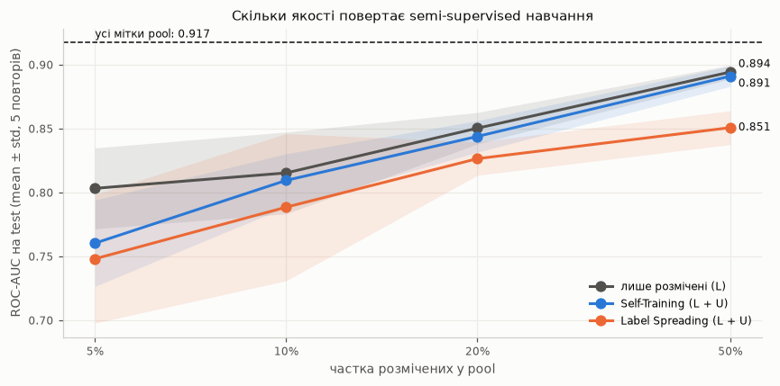
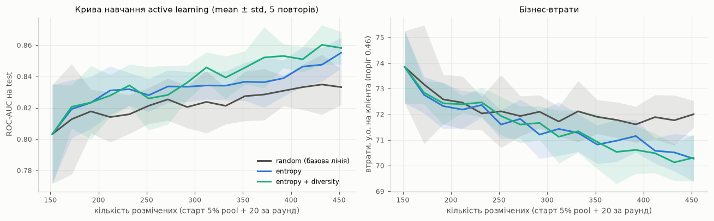

# ЛР4, трек 4A. Semi-supervised learning на частково розмічених даних

**Бізнес-сценарій.** Мітку «пішов / не пішов» отримуємо лише через місяць, тож на момент рішення частина бази ще без міток.
Робота відповідає на три питання:
1. **(ТЗ, п. 1)** Як побудувати частково розмічений набір?
2. **(ТЗ, п. 2)** Чи повертає semi-supervised алгоритм якість, втрачену через брак міток?
   - основний метод — **Self-Training** (варіант 1);
   - порівняння — **Label Spreading** (варіант 3, graph-based).
3. **(варіант 5, Human semi-supervised)** Яких клієнтів віддати експертові першими, щоб кожна мітка дала найбільше (**active learning**)?
   Це основа трекового модуля «черга розмітки» в ЛР5.

**Артефакти:**
- ноутбук: [notebooks/lab4a_semi_supervised.ipynb](../notebooks/lab4a_semi_supervised.ipynb);
- код: [src/semi_supervised.py](../src/semi_supervised.py); запуск: `python -m src.run_lab4a --split | --ssl | --al`;
- конфігурація: [config/lab4a.yaml](../config/lab4a.yaml);
- результати: `reports/lab4a_*`.

---

## 1. Частково розмічений набір (ТЗ, п. 1)

**Джерело.** `data/processed/train.csv` з еталонного DVC-знімка ЛР3: `dvc.api`, `rev = lab3-v1.0`, 4 059 клієнтів, відтік 16.6%.
Holdout ЛР3 **не використовується**: він лишається test-набором ЛР5.

**Розбиття** — стадія DVC `lab4a_split` → `data/processed/lab4a_split.csv`, стратифіковано, seed 42:

| Роль | Клієнтів | Призначення |
|---|---|---|
| **test** | 1 015 (25%) | лише оцінювання; мітки ніколи не беруть участі в навчанні |
| **pool** | 3 044 (75%) | розмічені **L** + нерозмічені **U** (мітки U приховані, але відомі «оракулу») |

Pool і test не перетинаються. Цього вимагає ЛР5: пул дорозмітки не може містити тестових клієнтів.

**Частки розмічених у pool** — 5 / 10 / 20 / 50%, стратифіковано, 5 повторів (seed 0–4). Нерозмічені позначено `y = −1` (конвенція `sklearn.semi_supervised`).

| Частка | L | з них відтік | U | відтік у U (прихований) |
|---|---|---|---|---|
| 5% | 152 | 25 | 2 892 | 0.166 |
| 10% | 304 | 50 | 2 740 | 0.166 |
| 20% | 608 | 101 | 2 436 | 0.166 |
| 50% | 1 522 | 253 | 1 522 | 0.166 |

**Модель і ізоляція міток:**
- препроцесор ЛР1–3 (конструктори, `AdaptiveImputer`, OOF-WoE, `ReviewTextSVD`, `SelectKBest(f_classif, 30)`) і класифікатор навчаються **лише на L**;
- класифікатор — як фінальна модель ЛР3: RF, 281 дерево, глибина 11, `class_weight {0: 50, 1: 118}`, бізнес-поріг 0.46;
- U використовується лише там, де це суть методу: псевдомітки Self-Training і граф Label Spreading;
- мітки U — тільки для оцінювання псевдоміток і як «відповіді експерта» в active learning.

---

## 2. Semi-supervised vs лише розмічені (ТЗ, п. 2)

**Методи:**

| Метод | Як працює | Ключові параметри |
|---|---|---|
| **Лише L** (бейзлайн) | RF навчається тільки на розмічених | — |
| **Self-Training** (основний) | RF на L → U-рядки з упевненістю ≥ θ отримують псевдомітку → перенавчання → … | θ = 0.90 (задано до експериментів), ≤ 10 ітерацій; `sklearn.semi_supervised.SelfTrainingClassifier` |
| **Label Spreading** (порівняння) | kNN-граф на L ∪ U: мітки «розтікаються» до сусідів, α — наскільки можна змінювати початкові мітки | k = 20, α = 0.2; ознаки шкальовані (конфігурація `additive`) |
| «Стеля» | RF на всіх мітках pool | — |

**Результати на test** (mean ± std, 5 повторів):

| Частка | Лише L | **Self-Training** | Label Spreading |
|---|---|---|---|
| 5% | **0.803 ± 0.032** | 0.760 ± 0.034 | 0.748 ± 0.050 |
| 10% | **0.815 ± 0.032** | 0.810 ± 0.021 | 0.789 ± 0.058 |
| 20% | **0.850 ± 0.012** | 0.844 ± 0.012 | 0.826 ± 0.013 |
| 50% | **0.894 ± 0.005** | 0.891 ± 0.008 | 0.851 ± 0.013 |
| «Стеля» (усі 3 044 мітки) | **0.917** | | |

Значення — ROC-AUC. Втрати (у.о./клієнта, матриця ЛР3) поводяться так само: при 10% міток лише L — 72.8, Self-Training — 73.4, Label Spreading — 74.0.

**Результат — негативний, і його документуємо.**
- Self-Training **не перевершив** навчання лише на розмічених за жодної частки міток: кращий лише в 0–1 з 5 повторів.
- Найбільше він програє при 5% (−0.043).
- Label Spreading слабший за обидва.

### Чому так: якість псевдоміток (порівняння з оракулом)

| Частка | Отримали псевдомітку | Точність псевдоміток | **Відтік серед псевдоміток** | Справжній відтік у U | Відтоків U, що отримали «відтік» |
|---|---|---|---|---|---|
| 5% | 81% | 0.894 | **0.072** | 0.166 | 36% |
| 10% | 78% | 0.917 | **0.072** | 0.166 | 42% |
| 20% | 76% | 0.930 | **0.064** | 0.166 | 46% |
| 50% | 70% | 0.961 | **0.054** | 0.166 | 59% |

1. **Підтвердне упередження (confirmation bias) на незбалансованих даних.** Упевнено (≥ 0.9) модель розмічає переважно «очевидних» клієнтів, що лишаються. Серед псевдоміток відтоку 5–7% проти 16.6% насправді, тож у навчання додається ~2 000 рядків класу 0 і ~150 класу 1. Розподіл зсувається до мажоритарного класу, і модель гірше ранжує відтік.
2. **Псевдомітки не несуть нової інформації.** Вони — прогнози тієї самої моделі на тих самих ознаках. Можна було б виграти, якби U розкрив структуру, яку L не бачить (припущення кластерів чи многовиду). Але відтік тут визначається кількома пороговими ознаками (стаж, скарга, частота замовлень), з якими RF справляється вже на 150–300 мітках.
3. **Чутливість до порогу** (10% міток):

   | θ | Отримали псевдомітку | Точність | Відтік серед псевдоміток | ROC-AUC |
   |---|---|---|---|---|
   | 0.70 | 98% | 0.854 | 0.157 | 0.815 |
   | 0.80 | 93% | 0.864 | 0.134 | 0.799 |
   | 0.90 | 78% | 0.917 | 0.072 | 0.810 |
   | 0.95 | 65% | 0.944 | 0.031 | 0.811 |

   Для порівняння, лише L — 0.815. Навіть коли частка відтоку серед псевдоміток стає реалістичною (θ = 0.7), якість лише **вирівнюється** з бейзлайном, а не перевищує його.
   Поріг 0.90 зафіксовано до експериментів; таблиця — аналіз чутливості, а не вибір за test.
4. **Label Spreading** спирається на припущення «сусіди в просторі ознак мають однакову мітку», а для відтоку воно слабке. Клієнти з однаковим профілем покупок ідуть або лишаються залежно від скарги чи стажу.
   Вибір k = 20 зроблено без міток, за будовою графа:
   - у **неорієнтованому** kNN-графі pool вузлів у компонентах без жодної мітки: при k = 5 — 45, при k = 10 і 20 — 0;
   - але sklearn поширює мітки **орієнтованим** kNN-графом, і при k = 10 ~2% вузлів не отримують «маси» міток (прогноз NaN → апріорна частка);
   - при k = 20 таких вузлів немає.

**Висновок для домену:** якщо міток мало, semi-supervised на цих даних не замінює розмітку. Ефективніше **правильно обрати, кого розмітити** (§4).

---

## 3. Справедливість псевдоміток і моделей (CACE)

Self-Training змінює склад навчальної вибірки, як SMOTE у ЛР3, тому аудит груп повторено. Нижче — 10% міток, seed 0.

| CityTier | у U | отримали псевдомітку | точність псевдоміток | відтік у U | відтік серед псевдоміток | **справжніх відтоків, що отримали «відтік»** |
|---|---|---|---|---|---|---|
| 1 | 1 795 | 79.6% | 0.931 | 0.144 | 0.074 | 25.5% |
| 2 | 113 | 78.8% | 0.966 | 0.168 | **0.022** | **10.5%** |
| 3 | 832 | 76.8% | 0.900 | 0.213 | 0.091 | 23.7% |

Псевдомітки **найгірше «знаходять» відтік у Tier 2**: лише 10.5% справжніх відтоків отримали мітку «відтік» проти ~25% в інших групах. Self-Training систематично посилює недопредставленість відтоку малої групи.

DPR/EOR на test (10% міток, 5 повторів, поріг 0.46, відносно Tier 1):

| Метод | Tier 2: DPR | Tier 2: EOR | Tier 3: DPR | Tier 3: EOR |
|---|---|---|---|---|
| Лише L | 0.66 ± 0.18 | 0.74 ± 0.27 | 1.15 ± 0.13 | **0.86 ± 0.05** |
| Self-Training | 0.72 ± 0.23 | 0.84 ± 0.33 | 1.06 ± 0.10 | **0.84 ± 0.09** |
| Label Spreading | 0.39 ± 0.24 | 0.65 ± 0.40 | 1.16 ± 0.19 | 0.97 ± 0.17 |
| «Стеля» (усі мітки) | 0.53 | 0.82 | 1.15 | 0.96 |

Для Tier 3 Self-Training трохи знижує EOR (0.86 → 0.84). Для Tier 2 оцінки нестійкі: у test лише ~40 клієнтів групи.
Висновок: semi-supervised не лише не покращує якість, а й **додає ризик для малої групи через псевдомітки**. Це ще один аргумент не використовувати його в продакшені на цих даних.

---

## 4. Active learning: кого віддати експертові (варіант 5 → ЛР5)

**Цикл:**
1. старт — 5% pool розмічено (152 клієнти);
2. модель (той самий конвеєр, лише L) обирає з нерозміченого pool **20 клієнтів**;
3. «експерт» (оракул) повідомляє мітки, і модель перенавчається.

Таких раундів 15, тобто бюджет 300 міток. 5 повторів, однаковий старт для всіх стратегій.

| Стратегія | Як обирає |
|---|---|
| `random` | випадково — **базова лінія** з тим самим бюджетом |
| `entropy` | максимальна ентропія прогнозу H(p) = −[p·log₂p + (1−p)·log₂(1−p)] |
| `entropy_diversity` | топ-100 за ентропією → KMeans(20) → найближчий до центру кожного кластера: невизначені, але не схожі між собою |

Для двох класів least confidence, margin і entropy — монотонні функції |p − 0.5|, тож вони дають **однакову чергу** (тест `test_binary_uncertainty_measures_rank_identically`). Тому порівнюється невизначеність проти невизначеності з різноманітністю.

| Розмічено | random | entropy | entropy + diversity |
|---|---|---|---|
| 152 (старт) | 0.803 | 0.803 | 0.803 |
| 252 | 0.821 ± 0.011 | **0.828** ± 0.011 | 0.826 ± 0.020 |
| 352 | 0.827 ± 0.016 | 0.837 ± 0.012 | **0.846** ± 0.011 |
| **452** | 0.833 ± 0.011 | 0.855 ± 0.010 | **0.858 ± 0.010** |
| Втрати при 452, у.о./клієнта | 72.0 | 70.3 | **70.3** |

Значення — ROC-AUC на test.

- **Active learning стабільно кращий за випадковий відбір.** Парна різниця в кінці бюджету:
  - `entropy_diversity − random` = **+0.025 ± 0.015**, від +0.014 до +0.048, тобто кращий у **всіх 5** повторах;
  - `entropy − random` = +0.022 ± 0.012.
- **Ефективність міток.** 452 мітки, обрані `entropy_diversity`, дають 0.858 — більше, ніж 608 випадкових міток (0.850, §2). Це на ~25% менше розмітки для тієї самої якості.
- **Чому працює:** серед запитаних невизначених клієнтів **~40% відтоку** проти 15.6% у випадкових. Експерт отримує саме ті приклади міноритарного класу, яких моделі бракує.
- **Склад запитів за CityTier** (entropy_diversity): Tier 1 — 63.9%, Tier 2 — 3.1%, Tier 3 — 32.9%; у pool — 65.2 / 4.3 / 30.5%. Tier 3 запитується трохи частіше, бо там вищий відтік і більше невизначеності. Tier 2 — трохи рідше, і це треба відстежувати в ЛР5.

---

## 5. Міст до ЛР5 (трековий модуль 4A «Weak & Active Learning»)

Збережено в `reports/lab4a_strategy.json`:

| Що потрібно ЛР5 | Рішення з ЛР4A |
|---|---|
| Міра `uncertainty` у `/v1/predict` | **ентропія** H(p), p = P(відтік \| x); 0 — певний, 1 — максимально невизначений |
| Стратегія черги | **entropy + diversity** (найкраща); `entropy` — простіша альтернатива |
| Пул дорозмітки | `data/processed/lab4a_split.csv`, `role == pool`; не перетинається з test ЛР4A і з holdout ЛР3 |
| «Оракул» | приховані мітки `Churn` з `train.csv @ lab3-v1.0` (розмітку симульовано — вказати в Data Card) |
| Базова лінія | випадковий відбір з тим самим бюджетом |
| Labeling functions | не використовувались |

---

## 6. Обмеження

- «Експерт» симульований: справжні мітки миттєві й безпомилкові. Реальний анотатор помиляється і коштує грошей; бюджет у 300 міток — умовний.
- Розмічена частка обиралась **випадково** (MCAR щодо міток). У реальності «нерозміченими» є передусім **нові** клієнти, а вони систематично інші (менший стаж і вищий відтік), тож розподіл L і U відрізнятиметься.
- Self-Training перевірено з одним базовим класифікатором (RF з вагами) і одним критерієм (поріг упевненості). Покращення, які варто спробувати: окремі пороги для класів, обмеження частки псевдоміток класу 1, «м'які» псевдомітки з вагою.
- Оцінка на одному фіксованому test (1 015 клієнтів), без вкладеної CV. Розкид показано повторами вибору L.
